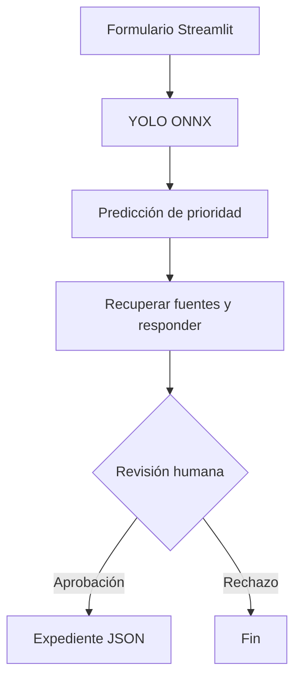

# VíaVision AI

Prototipo de inspección vial del Grupo 03, Sistemas Inteligentes, UNT. La interfaz enlaza detección de daños, prioridad estimada, evidencia documental y aprobación humana en un solo expediente.

## Ejecutar la demo local

Requiere Python 3.12. Abrir una terminal en esta carpeta.

```sh
python -m venv .venv
# Windows PowerShell: .venv\Scripts\Activate.ps1
# macOS/Linux: source .venv/bin/activate
python -m pip install -r requirements.txt
python -m streamlit run app.py
```

Abrir http://localhost:8501. En **Demostración**, usar la foto incluida y pulsar **Analizar tramo**. Cambiar el tráfico de 500 a 9800 vehículos/día y comparar el puntaje. Consultar «¿Cuándo aplica el parchado superficial en pavimento flexible?», abrir la fuente y la traza, aprobar la revisión y descargar el expediente JSON.

El modo local incluye recuperación con TF-IDF y citas. Para generación con LLM, copiar `.env.example` a `.env` y configurar una clave de OpenAI con acceso al modelo configurado. La clave se queda en el equipo y requiere conexión para el llamado. La app vuelve a la respuesta local si falla la API o la respuesta omite los identificadores de fuente. El LLM recibe el texto de la consulta y las fichas, sin la imagen ni las coordenadas.

## Reproducir métricas

```sh
python -m scripts.train_ml
python -m scripts.evaluate_demo
```

El primer comando genera 360 observaciones sintéticas de 120 tramos, entrena el baseline y dos candidatos, y guarda las métricas en `results/ml_demo.json`. El segundo ejecuta LangGraph, el detector ONNX y recuperación local, y guarda resultados y expediente en `results/demo.json` y `results/expediente_demo.json`.

Para entrenar con registros reales autorizados:

```sh
python -m scripts.train_ml --csv data_private/tramos.csv
```

El CSV debe incluir los encabezados del CSV de ejemplo, etiquetas de inspección en `prioridad_validada` y un identificador de agrupación. Usa `--grupo distrito` si el diseño experimental se basa en distrito y el archivo contiene esa columna. Usa el modo **Piloto con datos validados** después de generar `models/validado.joblib`. El artefacto del modo piloto depende de la calidad y procedencia del CSV.

## Arquitectura



La severidad del formulario se registra por inspección. Las cajas y confidencias del detector se adjuntan al expediente como evidencia visual. El puntaje es 50 × la esperanza de la escala ordinal 0, 1 y 2. El orden de los nodos y las decisiones quedan en la traza. La aprobación reanuda el mismo análisis con LangGraph.

## Datos, fuentes y alcance

- **Visión.** YOLO11n externo de Rishabh Aryan, ajuste publicado por el autor sobre el dataset de Lorenzo Arcioni. Se incorporó el ONNX del commit `31406345c784f2e66216f42a221627da2e26e7c8`. La imagen de demostración corresponde a `docs/samples/sample4.jpg` de la misma revisión. Puede compartir origen con el entrenamiento. Licencias y fuente en `docs/Fuentes.md`.
- **Prioridad.** Los datos de demostración provienen del generador incluido. Las métricas de ese conjunto describen la recuperación de patrones sintéticos. Para una validación vial se requiere un conjunto de registros etiquetados por inspección o un objetivo alternativo autorizado.
- **RAG.** Seis fichas curadas de FHWA y MTC, con paráfrasis identificadas por capítulo, sección y URL. La evaluación local mide recuperación. Verificar fidelidad de generación en pruebas con una clave propia.
- **Evaluación visual.** La demostración ejecuta inferencia real. Para obtener mAP y recall de campo se requiere un test anotado y separado por calle y recorrido.
- **Privacidad.** Utilizar fotos autorizadas y evitar rostros y matrículas. La identificación de un daño visible y el expediente son elementos preliminares de inspección.

## Entregables

La carpeta `docs/` reúne informe editable, presentación, póster, manuales y guion. Los resultados de ejecución están en `results/`. Completar la bitácora con la participación que realmente tenga cada integrante.

### Evaluar el detector en campo

`python -m scripts.evaluate_vision data_private/vision_test.json` calcula AP@50, recall al umbral de uso y falsas alarmas por recorrido. El archivo contiene una lista de objetos con los campos `imagen` (ruta relativa al manifiesto), `calle`, `recorrido` y `cajas` (lista de objetos `{"clase":"Bache","caja":[x1,y1,x2,y2]}`). Para el modelo incluido, las clases evaluables son Bache y Grieta. Conservar calles y recorridos de prueba fuera de cualquier ajuste y auditar duplicados antes de medir. Registrar las condiciones de cámara, humedad y sombra.

### Alcance territorial

El ámbito propuesto es la provincia de Trujillo, La Libertad. Selecciona el modo y registra el distrito, la vía o sector y, si las conoces, ambas coordenadas. La provincia y el departamento quedan fijos en el formulario y se guardan en el bloque 'ubicacion' del expediente. Las ubicaciones de la demo se exportan como simuladas. Para un piloto de campo, registra una foto y una ficha del mismo tramo.
