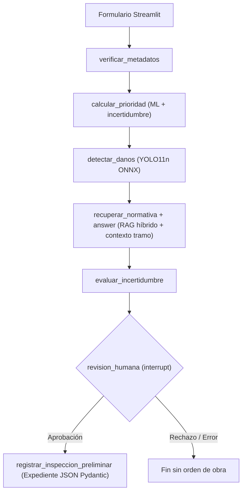

# VíaVision AI

Prototipo de inspección vial del **Grupo 11** (Sistemas Inteligentes — VI ciclo, Universidad Nacional de Trujillo, 2026-II). Integra detección visual de deterioros, estimación de prioridad tabular, recuperación documental normativa y aprobación humana mediante LangGraph en un expediente JSON validado con Pydantic.

- **Repositorio oficial:** https://github.com/k3vind0/ViaVision-AI
- **Integrantes y roles:**
  - **Kevin Alexis Alva Neciosup** — Ingeniería de Datos, ML y Visión Computacional
  - **Aguilar Meza Yolver Yonel** — LLM, LangChain y Pipeline RAG
  - **Chacon Garcia Anthony Alexander** — Orquestación LangGraph, UI Streamlit y QA

## Estructura del repositorio

```text
ViaVision-AI/
├── app.py                         # Interfaz Streamlit principal
├── configs/settings.yaml          # Parámetros centralizados (visión, ML, RAG, logging)
├── data_sample/                   # Corpus normativo (13 fichas), 2 fotos y CSV sintético
├── docs/                          # Documentación técnica, capturas y entregables académicos
├── models/                        # road_damage.onnx (YOLO11n) y demo.joblib
├── notebooks/Experimentacion.ipynb# Cuaderno reproducible ejecutado con salidas
├── results/                       # Métricas JSON/CSV, figuras PNG y expedientes
├── scripts/                       # Entrenamiento, evaluación visual/RAG y capturas
├── src/
│   ├── config.py                  # Carga YAML y logging estructurado (logs/viavision.log)
│   ├── schemas.py                 # Esquemas Pydantic v2 y contrato ExpedientePreliminar
│   ├── data/                      # Generador coherente por tramo y validación tabular
│   ├── ml/                        # Baseline por regla, candidatos, entrenamiento e inferencia
│   ├── vision/                    # Detector YOLO11n ONNX y evaluador de cajas
│   ├── rag/                       # Chunking, índice híbrido (TF-IDF + SVD) y asistente
│   ├── agents/                    # Grafo LangGraph tipado con interrupción humana
│   └── ui/                        # Componentes modulares de Streamlit
└── tests/                         # Suite automatizada pytest (ML, Visión, RAG, Grafo, UI)
```

## Ejecutar la demo local

Compatible con **Python 3.12 – 3.14** (Windows/Linux/macOS). Abrir una terminal en la carpeta `ViaVision-AI`:

```powershell
python -m venv .venv
.\.venv\Scripts\Activate.ps1
python -m pip install -r requirements.txt
python -m streamlit run app.py
```

Abrir `http://localhost:8501`. En **Demostración**, usar la foto incluida y pulsar **Analizar tramo**. Cambiar el tráfico de `500` a `9800` vehículos/día para observar la variación de prioridad, probabilidades e incertidumbre. Consultar `¿Cuándo aplica el parchado superficial en pavimento flexible?` o usar el chat contextual (`¿En qué sección se sustenta la prioridad?`), revisar las fuentes `[ID]` y la traza con latencias, aprobar la revisión y descargar el expediente JSON.

El modo local ejecuta recuperación híbrida offline (TF-IDF + índice vectorial denso SVD) con verificación de citas. Para activar redacción estructurada (Pydantic) con LLM, copiar `.env.example` a `.env` y configurar `OPENAI_API_KEY`. Si falla la API o la respuesta omite citas válidas, el sistema retorna automáticamente al respaldo local.

## Reproducir métricas, pruebas y capturas

```powershell
# 1. Instalar herramientas de prueba y notebook
python -m pip install -r requirements-dev.txt

# 2. Entrenar baseline y candidatos ML (genera demo.joblib, tablas, split y figuras PNG)
python -m scripts.train_ml

# 3. Verificar protocolo de evaluación visual sobre muestras incluidas
python -m scripts.evaluate_vision data_sample/vision_demo_manifest.json --output results/vision_demo.json --figure results/fig_vision_fhwa_analisis.png

# 4. Evaluar flujo LangGraph y banco RAG de 24 consultas (Sin-RAG vs Con-RAG)
python -m scripts.evaluate_demo

# 5. Ejecutar suite automatizada de pruebas
python -m pytest -v
```

Nota sobre archivos de resultados: `results/demo_antes_filtro.json` se conserva como registro histórico previo a la ampliación del filtro de dominio y guardia anti-inyección; `results/demo.json` contiene la evaluación vigente de 24 consultas y 11 comprobaciones funcionales.

Para entrenar con registros reales autorizados:

```powershell
python -m scripts.train_ml --csv data_private/tramos.csv
```

El CSV debe incluir las columnas de `data_sample/tramos_sinteticos.csv`, etiquetas en `prioridad_validada` (`baja`, `media`, `alta`) y un identificador de agrupación (`--grupo id_tramo` o `distrito`).

## Arquitectura integrada



## Datos, fuentes y alcance

- **Visión:** YOLO11n externo de Rishabh Aryan sobre el dataset de Lorenzo Arcioni (`commit 31406345c784f2e66216f42a221627da2e26e7c8`). `tramo-ejemplo.jpg` proviene de `docs/samples/sample4.jpg` de ese repositorio; `fhwa-bache.jpg` proviene de FHWA-HRT-13-092 (Fig. 28) e ilustra un error puntual (`Bache` clasificado como `Grieta` al 29 %). Para mAP de campo se requiere un conjunto anotado independiente por calle y recorrido.
- **Prioridad:** 360 filas sintéticas coherentes de 120 tramos (`tipo_via` constante y progresión anual por tramo). Las métricas reflejan el generador sintético mientras no se disponga de registros municipales validados.
- **RAG:** 13 fichas curadas y trazables de FHWA-HRT-13-092 y Manual de Carreteras MTC (conservación vial), con URL oficial, chunking, índice híbrido y evaluación sobre 24 consultas (12 contestables, 6 sin respaldo y 6 adversariales).
- **Alcance territorial:** Provincia de Trujillo, La Libertad. Las ubicaciones de demostración se exportan marcadas como `simulado`.
